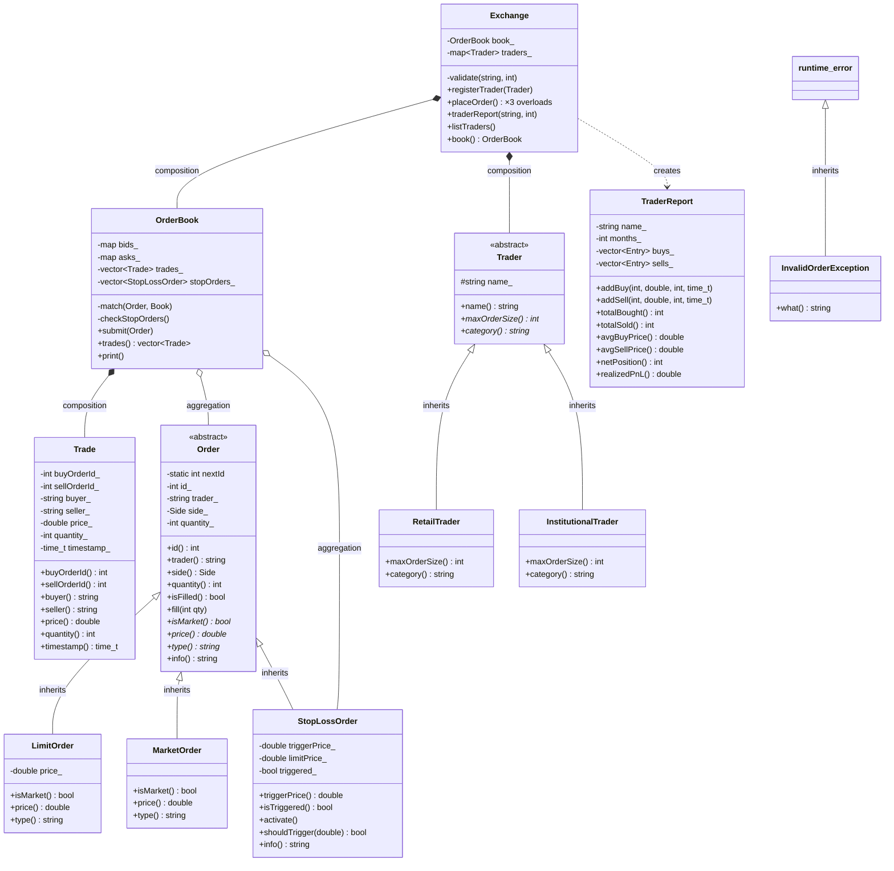

# Mini Stock Exchange (C++17)

A stock exchange matching engine demonstrating core OOP and software-engineering concepts in C++17.

## Features
- **Limit, Market, and Stop-Loss orders** matched by price-time priority (best price first, then oldest first).
- **Stop-loss cascade:** a triggered SL can cause trades that trigger further SL orders.
- **Trader reports:** per-trader buy/sell history, net position, and realized P&L over the last *N* months (average-cost method, like Zerodha Console).
- **Validation:** unknown traders, oversized orders, negative prices all throw typed exceptions.

## Project structure

```
mini-exchange/
├── CMakeLists.txt          # CMake build (Release / Debug, static lib + executable)
├── include/
│   ├── Types.hpp           # Side enum, formatDate helper, InvalidOrderException
│   ├── Order.hpp           # Order (abstract), LimitOrder, MarketOrder, StopLossOrder
│   ├── Trade.hpp           # Immutable trade record with timestamp
│   ├── Trader.hpp          # Trader (abstract), RetailTrader, InstitutionalTrader
│   ├── TraderReport.hpp    # Cold-path analytics: P&L and trade history
│   ├── OrderBook.hpp       # Hot-path matching engine
│   └── Exchange.hpp        # Top-level facade
├── src/
│   ├── Order.cpp
│   ├── Trade.cpp
│   ├── TraderReport.cpp
│   ├── OrderBook.cpp
│   ├── Exchange.cpp
│   └── main.cpp            # Demo / entry point
└── README.md
```

## Class relationships



## OOP concepts used
| Concept | Where |
|---|---|
| Encapsulation | `Order`, `Trade`, `OrderBook`, `TraderReport`: private data with const getters |
| Abstraction | Abstract classes `Order` and `Trader` (pure virtual functions) |
| Inheritance | `LimitOrder`/`MarketOrder`/`StopLossOrder` from `Order`; `RetailTrader`/`InstitutionalTrader` from `Trader` |
| Polymorphism (runtime) | Virtual functions called via base pointers (`type()`, `info()`, `maxOrderSize()`) |
| Polymorphism (compile time) | Function overloading (`placeOrder` × 3), operator overloading (`<<`), templates (`match`, `printAll`) |
| Constructors / destructors | Constructor overloading, initializer lists, virtual destructors |
| Static members | `Order::nextId` |
| Friend functions | `operator<<` for `Order`, `Trade`, and `TraderReport` |
| Composition | `Exchange` owns an `OrderBook`, its traders, and builds `TraderReport`s |
| Exception handling | `InvalidOrderException` |
| Dynamic cast | `dynamic_pointer_cast` to identify `StopLossOrder` at runtime |
| Nested struct | `Entry` inside `TraderReport` groups trade line-item fields |

## Build and run

### Prerequisites
- CMake ≥ 3.16
- g++ (C++17) or clang++
- Ninja (recommended) or Make

### Configure and build (Release)
```bash
cmake -S . -B build -G Ninja -DCMAKE_BUILD_TYPE=Release
cmake --build build
./build/exchange        # Windows: .\build\exchange.exe
```

### Debug build (with sanitizers-ready flags)
```bash
cmake -S . -B build-dbg -G Ninja -DCMAKE_BUILD_TYPE=Debug
cmake --build build-dbg
```

### Legacy single-file build (still works)
```bash
g++ -std=c++17 -Wall -Wextra -o exchange main.cpp   # from v1.0-single-file tag
```

## Possible next steps
- Order cancellation and modification
- Multiple symbols (`RELIANCE`, `TCS`, …)
- Unit tests (Google Test via CMake `FetchContent`)
- Performance benchmark (flat arrays, fixed-point prices)
- WebSocket/HTTP API layer (Python or Go client)
