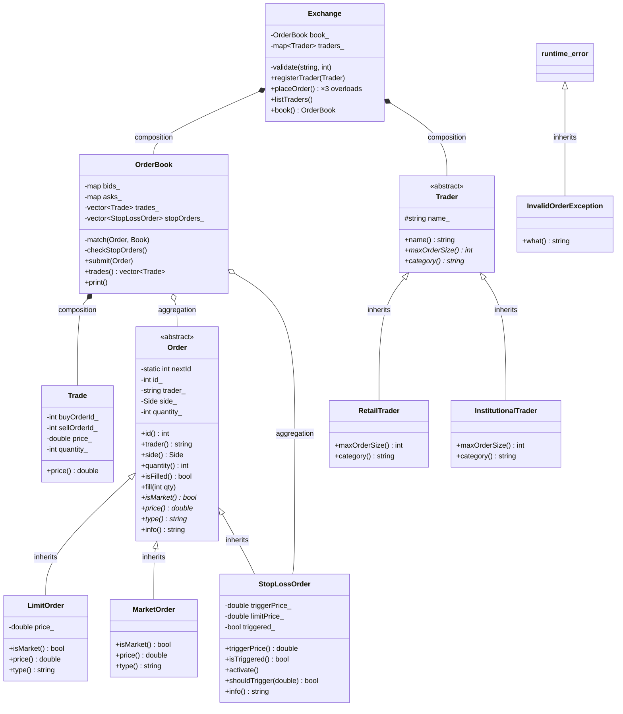

# Mini Stock Exchange (C++17)

A small order-matching engine that demonstrates core object-oriented programming concepts in C++.

## What it does
- Traders place **limit**, **market**, and **stop-loss** orders (buy or sell).
- Orders are matched by **price-time priority**: best price first, and the oldest order first at the same price.
- **Stop-loss orders** stay pending until the last traded price crosses a trigger level, then activate as limit orders — just like Zerodha's SL orders.  Triggered stop-losses can cascade (one trigger causes trades that trigger another).
- Unmatched limit orders rest in the order book; trades are recorded and printed.
- Invalid orders (bad price, unknown trader, size above the trader's limit) are rejected with exceptions.

## Class relationships



## OOP concepts used
| Concept | Where |
|---|---|
| Encapsulation | `Order`, `Trade`, `OrderBook`: private data with const getters |
| Abstraction | Abstract classes `Order` and `Trader` (pure virtual functions) |
| Inheritance | `LimitOrder`/`MarketOrder`/`StopLossOrder` from `Order`; `RetailTrader`/`InstitutionalTrader` from `Trader` |
| Polymorphism (runtime) | Virtual functions called via base pointers (`type()`, `info()`, `maxOrderSize()`) |
| Polymorphism (compile time) | Function overloading (`placeOrder` × 3), operator overloading (`<<`), templates (`match`, `printAll`) |
| Constructors / destructors | Constructor overloading, initializer lists, virtual destructors |
| Static members | `Order::nextId` |
| Friend functions | `operator<<` for `Order` and `Trade` |
| Composition | `Exchange` owns an `OrderBook` and its traders |
| Exception handling | `InvalidOrderException` |
| Dynamic cast | `dynamic_pointer_cast` to identify `StopLossOrder` at runtime |

## Build and run
```bash
g++ -std=c++17 -Wall -Wextra -o exchange main.cpp
./exchange        # on Windows: exchange.exe
```

## Possible next steps
- Order cancellation and modification
- Multiple symbols
- Unit tests and a performance benchmark
- Split into headers and source files
